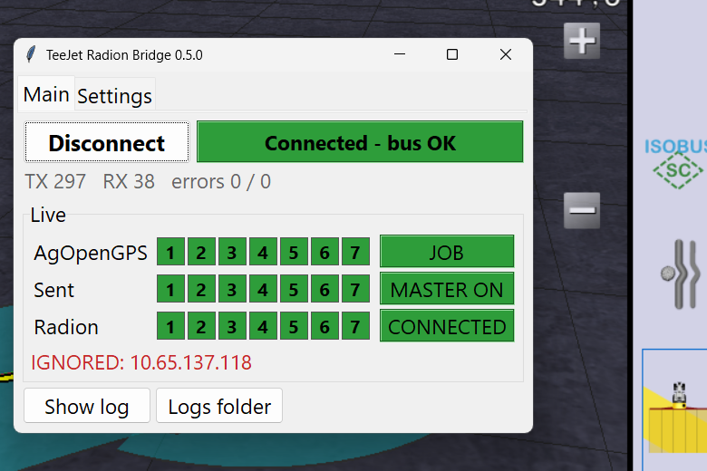
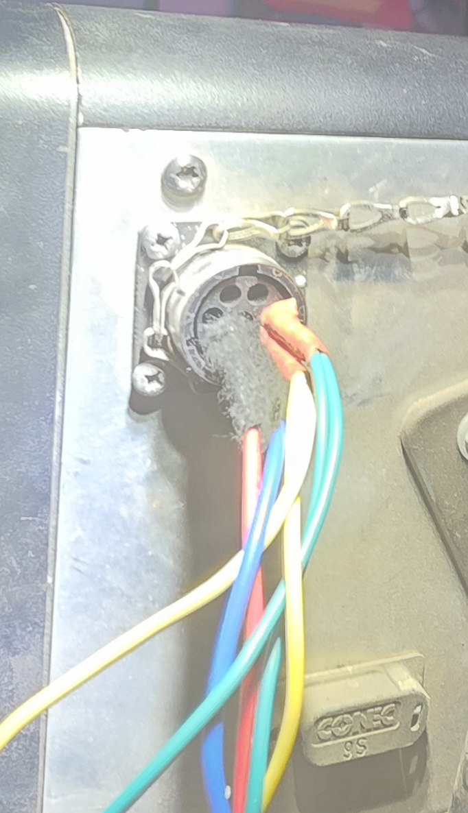

# AOG ↔ TeeJet Radion 8140 BoomPilot Bridge

Lets **AgOpenGPS** switch the boom sections of a **TeeJet Radion 8140** rate controller over CAN,
replacing the BoomPilot function of the Matrix Pro 570GS console. The Radion's *actual* section
state is read back and reported to AgOpenGPS.

```
 AgOpenGPS / AgIO                 Bridge (PC + PCAN-USB)               Radion 8140 (SA B4)
 +------------------+   UDP    +-------------------------+   CAN    +------------------+
 | 239/229 sections |--:8888-->| impersonates console C0 |--------->| 0A heartbeat     |
 | 254 speed, hello |          | only AgIO in its subnet |  250k    | 02 master        |
 | 0xF1 ISOBUS btn  |          |                         |          |                  |
 |                  |<-:9999---| 0xF0 ISOBUS actual,     |<---------| 00 SS ... actual |
 | maps coverage    |          | 0xED, hello 123, 203    |  29-bit  | 02 00 status     |
 +------------------+          +-------------------------+          +------------------+
```



The AOG side follows the proven **AOG_AGTronik_bridge** (Agromehanika) pattern. The protocol
details and what is still unknown are in [FINDINGS.md](FINDINGS.md). The CAN captures it is based
on are in [traces/](traces/README.md).

## Running

**Windows exe:** download `AOG-TeejetBoomPilot.exe` from [Releases](../../releases), or build it
locally with `build.bat` (output: `dist\AOG-TeejetBoomPilot.exe`). Logs and `config.ini` are
written next to the exe.

**Releasing:** push a tag such as `v0.1.0`. The
[workflow](.github/workflows/release.yml) runs the tests, builds the exe on Windows and attaches
it to a GitHub release. "Run workflow" in the Actions tab builds the exe as an artifact without
releasing it.

**From source:**
```bat
pip install -e .[dev]
teejet-bridge            (opens the window; same as: python -m teejet_bridge)
```

### The window

**Main tab** (about 400 × 260 px)
- **Connect / Disconnect** and the connection state: green when connected and the CAN bus is OK,
  red on ERROR-PASSIVE or BUS-OFF. TX/RX counters and errors below it.
- **Live**: three rows of section boxes with a status box each:
  *AgOpenGPS* (what AOG wants; JOB / NO JOB / NO DATA), *Sent* (MASTER ON/OFF and the sections
  sent to the Radion) and *Radion* (what the Radion reports open; CONNECTED / LOST).
- Warnings appear under the rows only when needed: ignored AgIO senders from another network
  (red), or the Radion's actual sections differing from the command (orange).
- **Show log** makes the window taller and shows the log, plus detail lines: AgIO address, speed,
  the frame sent, the ISOBUS state, and the Radion's SS / status / ID / b2–b5. **Logs folder**
  opens the logs folder. "Recording" is shown in red while a capture is running.

Closing the window or pressing Disconnect sends *master off + all sections off* three times
before releasing the bus.

**Settings tab** (saved to `config.ini` immediately; CAN, sections, subnet and ISOBUS take
effect on the next Connect)

| Setting | Default | Meaning |
|---|---|---|
| Interface / Channel | `pcan` / `PCAN_USBBUS1` | **Detect** lists the adapters plugged in. Bitrate is fixed at 250 kbit/s |
| Sections | 7 | [−] / [+], 1–24. Must match the section count of the tool in AOG |
| Module subnet | `192.168.5` | Only AgIO packets from `<subnet>.x` are used. Others (e.g. another AgIO on a Wi-Fi hotspot) are ignored. Replies go to `<subnet>.255`. AgIO's Ethernet window can change it (PGN 201) and find the bridge with Scan (PGN 202/203) |
| ISOBUS feedback | on | Sends PGN 0xF0 like an ISOBUS Task Controller with the Radion's **actual** sections. AOG paints coverage from what the Radion really sprays, and its ISOBUS section-control button switches BoomPilot on/off |
| Language | system language | Dropdown filled from the `lang` folder (see Translations) |
| Wireshark capture | off | Records `capture-*.pcapng` (CAN as SocketCAN + AOG UDP, opens in Wireshark) and `can-*.trc` (PCAN-View) in the logs folder. Can be switched on and off while connected |
| Show advanced / bench test options | off | Shows the bench-test switches: stop the 0x0A heartbeat (bench test 5), force master OFF (bench test 2), C0 address claim, Machine Selected Speed. Not needed in normal use |

Fixed in the app: UDP ports 8888/9999, master follows the AOG job, feedback via 0xED + hello
(+ ISOBUS). Experts can still change these in `config.ini` `[bridge]`: `listen_port`, `send_port`,
`master_mode` (`job`/`mask`), `feedback` (`feedback`/`override`), `remap` (e.g. `7,6,5,4,3,2,1`),
`aog_timeout` (1.0 s), `radion_timeout` (3.0 s), `rc_switchbox`, `hb_speed`, `broadcast`.

> **override warning:** use `feedback = override` only if bench test 3 shows the Radion reports
> its *switch* state. If it reports *commanded AND switches*, a section AOG turns off reads as
> "closed", gets forced off, and never comes back.

### Translations

All window text comes from `lang\<code>.ini` next to the exe, created on first start (English
and Hungarian are included). To add a language, copy `en.ini` to e.g. `de.ini`, change
`name =` under `[meta]`, translate the text after each `=` (keep `{placeholders}`), save as
UTF-8 and restart. Missing lines fall back to English.
Files you haven't edited are updated automatically when a new version changes the built-in
texts. Edited files are kept, and new lines in them fall back to the built-in text.

### Safety behaviour

- AOG sends section PGNs 239/229 only while a job is open. If none arrive for more than 1 s, the
  bridge sends `02 00` + `00 00 00 00` and keeps the 0x0A heartbeat running, so the Radion stays
  connected but leaves BoomPilot.
- The Radion counts as **lost** after 3 s without a frame. The hello reply to AgIO is only sent
  while the Radion is connected, so the green machine icon in AgIO means the Radion is there.
  The ISOBUS heartbeat then reports 0 sections, so AOG's ISOBUS button shows "idle" and AOG
  goes back to mapping coverage by itself instead of painting stale data.
- AOG's ISOBUS section-control button switched off: master off + all sections off, so the
  Radion falls back to its own switches. Switched on again: BoomPilot follows AOG.
- At Connect the bridge starts with ISOBUS section control **enabled** (BoomPilot follows AOG).
  When the Radion first reports its sections, the bridge flips the ISOBUS flag once so AOG
  redraws its button as "on". Otherwise AOG keeps showing "idle" until the button is pressed twice.
- CAN ERROR-PASSIVE, BUS-OFF and TX failures are logged in red. PCAN auto-reset from bus-off is enabled.

## Wiring

The Radion connects to the console through an **8-pin Souriau** connector (exact part number:
**TODO**). The bridge needs only **+12 V, GND, CAN_H and CAN_L** from it. Section and speed
information travel over CAN, not on discrete wires.



Pinout of the Radion's **Souriau 8-pin** console connector (pins are lettered on the connector face):

| Souriau pin | Signal |
|---|---|
| C | +12 V |
| D | GND |
| E | CAN_H |
| F | CAN_L |
| others | not used by the bridge |

Before connecting, check with a meter: C–D is the 12 V supply, and E–F measures about 60 Ω with
everything unpowered and both terminators fitted.

**PC side:** the PEAK PCAN-USB adapter itself has a DB9 plug (standard CiA 303-1 pinout). Wire
Souriau E (CAN_H) to DB9 pin 7, F (CAN_L) to pin 2 and D (GND) to pin 3. Pin C (+12 V) does
not go to the PCAN-USB; the adapter does not power the bus, so the Radion needs its own 12 V supply.

**Termination:** the bus needs **120 Ω at each end**: one at the Radion end and one at the
PCAN end (a terminator on the PCAN-USB's DB9, or a resistor between its pins 2 and 7). With everything unpowered,
measure **≈ 60 Ω** between CAN_H and CAN_L. 120 Ω means one terminator is missing; ~40 Ω means
there is one too many. Bus speed is 250 kbit/s with 29-bit IDs.

## AgOpenGPS setup

- Run the bridge on the same PC as AgIO. This PC needs a network adapter in the module subnet
  (default 192.168.5.x, e.g. the Ethernet port to the AOG modules); the log warns if it has
  none. AgIO broadcasts to `<subnet>.255:8888`, and the bridge answers on 9999 like a machine
  module.
- AgIO **Ethernet** window: **Scan** lists the bridge as the machine module. **Send subnet**
  moves the bridge too, and it saves the new subnet to `config.ini`.
- **ISOBUS button:** with ISOBUS feedback on, AOG shows its ISOBUS section-control button.
  Green/on = BoomPilot follows AOG. Off = Radion manual. Coverage is painted from the Radion's
  actual sections either way.
- Don't run a real ISOBUS Task Controller (AgIsoStack TC) at the same time: it also sends 0xF0.
- In AOG, set the tool's section count to match **Sections**.
- Section bits come from PGN 239 (sections 1–16) and 229 (up to 64; the bridge uses up to 24).

## Logs

`logs/` next to the app (**Open logs folder** on the main tab):
- `teejet-bridge.log`: text log, always on, rotating.
- With **Wireshark capture** on: `capture-YYYYMMDD-HHMMSS.pcapng` (CAN + AOG UDP, new file
  every 50 MB) and `can-YYYYMMDD-HHMMSS.trc` (every CAN TX/RX in **PCAN-View v1.1** format,
  rotating at 5 MB; also readable with `teejet-bridge decode`).

## Command line

```bat
teejet-bridge                          window (default)
teejet-bridge run --channel PCAN_USBBUS1 --sections 7     headless, status line, Ctrl-C = safe stop
teejet-bridge decode traces\*.trc      annotate PCAN-View traces + rates + section-mask summary
teejet-bridge decode --summary FILE    rates and mask changes only
```

## Development

```bat
pip install -e .[dev]
pytest
```

Tests cover frame encode/decode, the AOG PGN layouts, scheduler rates on the python-can `virtual`
bus, and the bridge end-to-end (loopback UDP ↔ virtual CAN with a test-only fake Radion). They
also run the trace decoder against `traces/`, asserting the recorded section-mask sequences.

Layout: `frames.py` (all CAN frame definitions), `aog.py` (AOG PGNs, with source references),
`scheduler.py` (the single timing loop), `console.py` (console emulation and Radion monitor),
`bridge.py`, `canio.py`, `trc.py`, `decode.py`, `gui.py`, `cli.py`.
